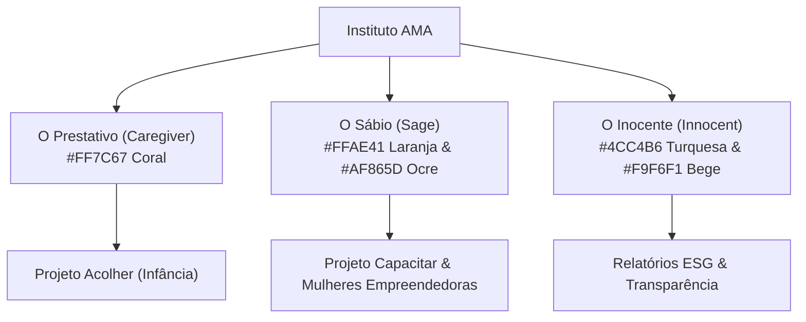

# Instituto AMA — Design System & Guia de Aplicação de Marca

O **Instituto AMA (Acolhimento, Mentoria e Assistência)** é uma organização de impacto social autônoma fundada em 2021 em São Luís/MA (Vila Mauro Fecury I). Este Design System consolida o **Playbook de Marca**, a **Arquitetura de Percepção Operável (APO)** e o **Manual de Redação e Governança Web**.

---

## 1. Posicionamento Estratégico & Dualidade de Marca

A comunicação do Instituto AMA opera sob uma **dualidade controlada** para unir o rigor institucional ao afeto comunitário:

| Dimensão | Público-Alvo | Slogan Oficial | Tom de Voz & Estética |
| :--- | :--- | :--- | :--- |
| **B2B / Corporativo / ESG** | Investidores, Empresas, Órgãos Públicos | *"Transformando afeto em futuro."* | Técnico, sóbrio, elegante, focado em governança, engenharia de impacto e resultados auditados. |
| **B2C / Comunitário / Pedagógico** | Beneficiários, Famílias, Comunidade | *"Amor que acolhe. Sabedoria que transforma."* | Afetivo, acolhedor, vibrante, focado na jornada humana e no desenvolvimento individual. |

---

## 2. Cromatismo Estratégico (Paleta de Cores)

### Cores Base B2B / Institucionais
- **Fundo Predominante B2B (Bege Areia):** `#F9F6F1` / Tailwind: `bg-surface-50` ou `bg-[#F9F6F1]`
  - Transmite sofisticação, calor e sobriedade editorial.
- **Títulos e Textos Principais (Marrom Quente / Grafite):** `#2D2825` e `#6B5247` / Tailwind: `text-stone-600` ou `text-[#2D2825]`
- **Texto de Apoio / Descritivos:** `#938D8A` / Tailwind: `text-neutral-500` ou `text-[#938D8A]`
- **Tom de Transição / Selo de Origem (Argila Quente / Ocre Dourado):** `#AF865D`
  - Utilizado em destaques de tópicos, selos e bordas nobres.

### Cores dos Projetos de Ponta (Tags Coloridas B2C)
- **Coral (Projeto Acolher):** `#FF7C67` / Tailwind: `text-primary-500`, `bg-primary-500`
  - Representa o arquétipo do *Prestativo (Caregiver)* — Afeto, proteção e acolhimento infantil.
- **Laranja (Projeto Mulheres Empreendedoras):** `#FFAE41` / Tailwind: `text-secondary-500`, `bg-secondary-500`
  - Representa o arquétipo do *Sábio (Sage)* — Autonomia, transformação e empreendedorismo.
- **Turquesa (Projeto AMA / Transparência):** `#4CC4B6` / Tailwind: `text-accent-500`, `bg-accent-500`
  - Representa o arquétipo do *Inocente (Innocent)* — Esperança, renovação e transparência ESG.
- **Verde (Projeto Capacitar):** `#2E6B5E` / Tailwind: `text-emerald-600`, `bg-emerald-600`
  - Qualificação profissional, futuro e bolsas de estudo para jovens.

---

## 3. Ecossistema Arquetípico



---

## 4. Tipografia & Rigor Editorial

- **Família Tipográfica Oficial:** `Poppins` (Google Fonts).
- **Títulos B2B:** `Poppins Bold` ou `SemiBold`, preferencialmente em caixa alta com *tracking* positivo (+5% a +10%) para ampliar a clareza institucional.
- **Corpo de Texto:** `Poppins Light` sobre fundos escuros e `Poppins Regular` sobre fundos claros.
- **Proibição Inegociável:** É **estritamente proibido** o uso de fontes manuscritas, decorativas ou cursivas em documentos e interfaces B2B.

---

## 5. Regras de Exposição & Proibições Visuais

- **Área de Respiro (Clear Space):** Manter espaço livre ao redor da marca proporcional à altura da letra "A" do logotipo.
- **Flat Design:** A marca opera na lógica de Flat Design. Proibido uso de gradientes ruidosos, contornos (*strokes*), sombras projetadas pesadas ou efeitos 3D em comunicações corporativas B2B.
- **Elementos 3D (B2C):** Renders 3D (corações, foguetes, lâmpadas) são permitidos exclusivamente em materiais infantis, cartilhas comunitárias e redes sociais B2C.
- **Nomenclatura Sophia:** Referir-se a ela obrigatoriamente como *"Sophia: Tecnologia de Aprendizado Multissensorial"*.

---

## 6. Hierarquia de Selos

1. **Selo AMA de Origem:** Aplicado em tags e embalagens de produtos manufaturados pelas Mulheres Empreendedoras. Uso estritamente monocromático em Marrom Quente (`#4A3525`), Ocre Dourado (`#AF865D`) ou impresso diretamente em papel Kraft.
2. **Selo Institucional / Legal:** Uso em contratos, ofícios e CNPJ. Monocromático em B2B; colorido em B2C.
3. **Selo Amigo AMA:** Concedido a parceiros corporativos e investidores ESG para aplicação em sites e relatórios de sustentabilidade.

---

## 7. Componentes de Interface & Padrões HTML/Tailwind

Ao desenvolver ou refatorar páginas do Instituto AMA no Pinegrow, utilize os padrões estabelecidos:

### Cartão de Equipe (`data-pgc="team-member"`)
```html
<div class="bg-surface-50 border border-surface-200 duration-300 flex flex-col group p-8 rounded-[2.5rem] space-y-2 transition-all hover:-translate-y-2 hover:bg-white hover:border-primary-200 hover:shadow-2xl hover:shadow-primary-500/5" data-pgc="team-member">
    <div class="flex items-center relative space-x-4 space-y-2">
        <div class="bg-white border border-surface-100 flex h-20 items-center justify-center relative ring-4 ring-primary-50 rounded-full shadow-sm text-4xl w-20" data-pgc-field="avatar">👨🏽‍💼</div>
        <div>
            <h3 class="font-extrabold font-sans text-base text-stone-600 transition-colors group-hover:text-primary-600" data-pgc-field="name">Nome do Membro</h3>
            <span class="inline-block self-center text-stone-500 text-xs uppercase font-semibold" data-pgc-field="role">Cargo / Função</span>
        </div>
    </div>
    <div class="flex-1 flex flex-col pt-2">
        <p class="text-sm text-neutral-500 leading-relaxed font-sans" data-pgc-field="bio">Descrição ou minibiografia funcional.</p>
    </div>
</div>
```

### Cartão de Projeto / Ação (`data-pgc="ama-project-card"`)
```html
<div class="bg-white p-6 rounded-3xl border border-surface-200 shadow-xs hover:shadow-md transition-all duration-300 group" data-pgc="ama-project-card">
    <div class="flex items-center gap-2 mb-4">
        <span class="w-2 h-2 rounded-full bg-primary-500"></span>
        <span class="text-[10px] font-bold text-primary-500 uppercase tracking-wider" data-pgc-field="tag">Nome do Projeto</span>
    </div>
    <h4 class="font-extrabold font-sans mb-2 text-lg text-stone-500 transition-colors group-hover:text-primary-600" data-pgc-field="title">Responsáveis</h4>
    <p class="text-xs text-neutral-500 leading-relaxed font-sans" data-pgc-field="description">Resumo das atividades e impacto.</p>
</div>
```

### Botões Institucionais
- **Botão Primário (B2B/Geral):** `bg-primary-500 text-white rounded-full font-bold px-8 py-4 hover:bg-primary-600 transition-all shadow-xl hover:-translate-y-1`
- **Botão Secundário:** `border border-primary-200 text-primary-500 rounded-full font-bold px-6 py-2.5 hover:bg-primary-50 transition-all`

---

## 8. Dados Cadastrais & Métricas Oficiais Auditadas

Sempre que redigir ou validar conteúdos do site, mantenha a fidelidade aos dados oficiais:

- **Razão Social:** INSTITUTO AMA | Acolhimento, Mentoria e Assistência
- **CNPJ Oficial:** `48.722.909/0001-80`
- **Endereço da Sede:** Travessa Principal, S/N, Vila Mauro Fecury I, São Luís – MA
- **Métricas Oficiais:**
  - **+4.200** Atendimentos Integrados (Saúde, Odonto, Jurídico, Assistência)
  - **120** Crianças Acolhidas (Projeto Acolher + Tecnologia Sophia)
  - **80** Mulheres Empreendedoras (Oficinas e Selo AMA de Origem)
  - **60 + 30** Jovens Qualificados e Bolsistas (Projeto Capacitar)
